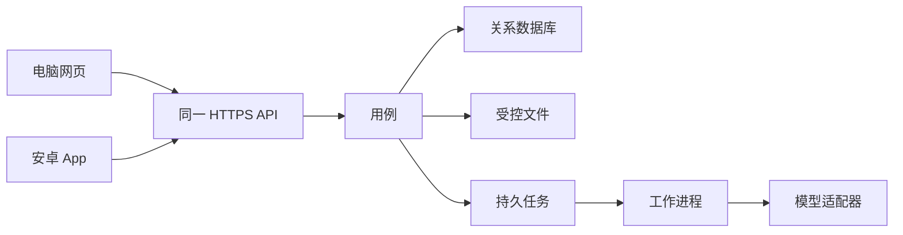
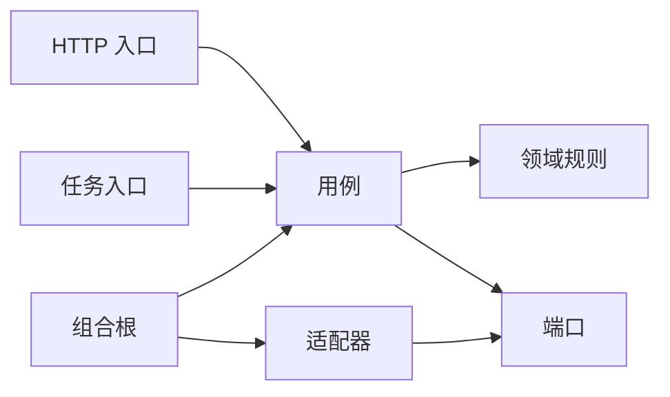

# ARCHITECTURE

状态：采纳的结构规则。服务端和网页技术栈见 ADR 0012。安卓界面和部署地点仍未拍板。2026-11-14。
产品范围见 [PRD.md](PRD.md)。协作见 [RULES.md](RULES.md)。

## 设计目标

按优先级：

1. 正式学习记录只来自老师确认，历史卷不被后来的题库修改改写。
2. 换模型、换界面、加一本练习册时，不改 R1–R6 的执行点。
3. 拿一个 request_id 能找到失败的那一层。
4. 多个 agent 可以按切片并行，热点文件少。
5. 部署保持一个模块化单体，直到测量证明要拆。

未测量的吞吐、延迟和准确率不作为目标数字。

## 不变量

所有入口执行同一套规则。入口包括老师网页、安卓 App、以后的客户端、后台任务。页面按钮不是规则的来源。

| 编号 | 规则 | 违反时 |
| --- | --- | --- |
| R1 | 题目版本和适用答案版本都已核准，才能正式出卷和自动评分 | 拒绝并给出原因。已发出的历史例外只能人工评分并留痕 |
| R2 | 已发出的学生卷能追溯当时的题目、答案和版面 | 改题库不改旧卷。已知错误只发风险提示，由老师复核 |
| R3 | 老师确认之前，AI 输出不是正式结论 | 失败、看不清、缺证据时等待老师。重跑只形成新建议 |
| R4 | 每一页、每一次作答对应到正确的学生卷 | 归属不确定就进入待核对，不猜测 |
| R5 | 确认和更正留痕。相同确认不写两份 | 并发冲突要提示。更正是新记录，不抹掉原建议 |
| R6 | 学习记录按老师负责的学科和学生授权 | 未授权的请求拒绝。链接和二维码不授权 |

实现点：HTTP 依赖 `require_actor`。practice 的 `Authorizer` 不变。未登录不是授权，先 401。已登录但没有该学生和学科的授权，用例仍拒绝。

## 进程



试点部署地点未拍板，见 ADR 0010。默认计划是机构电脑上的服务，手机通过受控局域网访问。手机不使用电脑的 localhost。不把服务无控制地公开到公网。首版不承诺离线。

上云时的最低顺序：暂停或控制写入，一起备份数据库和文件，在新环境恢复并核对数量、校验值和权限，用受控用例验证，再切换入口。已经产生的新写入不能被旧备份直接覆盖。这个顺序还没有演练。

## 分层

源码依赖只能向内。内圈不出现外圈的名字。



界面 → 用例接口 → 领域。一个用户操作进入用例一次。跨边界只传普通数据：标识、版本、文本、错误码。不传界面组件，不传数据库行，不传供应商原始响应。错误用 `Ok` 或 `Err`，业务拒绝不用异常来表示。大文件传标识，不把照片放进日志或领域对象的字符串里。

## 依据

方案 1.1 第 7 节已经选择模块化单体、端口和 R1–R6。本文件把那些选择写成可以检查的规则。Clean Architecture 的依赖方向用来约束 import。深模块用来决定切片，不按步骤切。日志字段按要能用请求 ID 排障来定。运行日志和审计日志的保留天数见 ADR 0030。

## 目录

第一段代码创建了 `catalog` 和 `practice`。2026-11-18 起，`scripts/check.conf` 的 `PHASE_SLICES` 是 `catalog practice identity`。空白配置仍回落到 `catalog` 和 `practice`。非空环境变量 `PHASE_SLICES` 覆盖该行。放宽时先改本文件和执行计划，再改配置。`knowledge`、`analysis`、`delivery` 等有代码再加目录，不预先铺空包。桌面壳不在第一段。`kernel` 和 `bootstrap` 始终允许，不写进这个名单。登录和审计的计划见 [docs/exec-plans/active/identity-and-audit.md](docs/exec-plans/active/identity-and-audit.md)。

```text
backend/kernel/                 LogEvent、Logger、Ok、Err
backend/bootstrap/compose.py    组合根。装配适配器、合成 PDF 和健康正文
backend/bootstrap/http_app.py   HTTP 入口。操作者来自服务端会话
backend/bootstrap/health.py     GET /health 正文。只有 status，不表示数据库就绪
backend/catalog/                核准快照。内存适配器
backend/identity/               登录、老师、学生和授权。内存适配器与 PostgreSQL
backend/practice/               出卷、确认和合成 PDF。授权结果来自 Authorizer
backend/<slice>/api.py          其他切片唯一可以导入的入口
apps/web/                       React 页面。只调用 HTTP，不导入 backend
apps/android/                   尚未创建
```

切片名只允许：`catalog`、`knowledge`、`identity`、`practice`、`analysis`、`delivery`。

## 依赖允许

行可以依赖列。空格表示不可以。`api` 表示只能导入该切片的 `api` 模块。

| 从 \ 到 | kernel | 本切片 domain | 本切片 application | 本切片 adapters | 其他切片 | 框架和供应商 SDK |
| --- | --- | --- | --- | --- | --- | --- |
| domain | 可以 | 可以 |  |  |  |  |
| application | 可以 | 可以 | 可以 |  | 只限 api |  |
| adapters | 可以 | 可以 | 可以 | 可以 | 只限 api | 可以 |
| 其他切片 |  |  |  |  | 见上 |  |
| 组合根 | 可以 |  | 可以 | 可以 | 可以 | 可以 |
| 网页 / App |  |  |  |  | 只通过 HTTPS API | 只限自己的 UI 框架 |

`scripts/check_boundaries.py` 检查 domain、application、adapters、kernel 和组合根的 import。相对导入先按源文件所在的包解析成绝对模块，再套用同一张允许表。它也禁止 `utils`、`helpers`、`common`，并拒绝 `PHASE_SLICES` 之外的切片目录、安卓工程、桌面壳和 Electron。组合根里的业务分支查不到，标 review。语言专用的 import-linter 或 dependency-cruiser 仍不引入。栈已按 ADR 0012 采纳，继续用这一支脚本。

## 禁止

| 编号 | 禁止 | 为什么 | 怎么拦 |
| --- | --- | --- | --- |
| F-01 | 界面或控制器决定能否出卷、能否确认 | R1、R3 会分叉 | review。core 测试走用例 |
| F-02 | domain 或 application 导入框架、ORM、模型 SDK | 内圈会绑死供应商 | `scripts/check_boundaries.py` |
| F-03 | 导入其他切片的 domain、application、adapters。绝对导入和等价的相对导入都算 | 边界会漏 | 同上，只能导入 `api`。相对导入先按源文件所在的包解析 |
| F-04 | 新建 utils、helpers、common | 变成垃圾桶 | 同上 |
| F-05 | 把 AI 建议写成正式确认 | 破坏 R3 | review，加 core 测试 |
| F-06 | 覆盖旧学生卷的题目或答案快照 | 破坏 R2 | review，加 core 测试 |
| F-07 | core 里 `print` 或 import 具体日志库 | 日志无法替换，也不能统一字段 | `scripts/check_logging.py` |
| F-08 | 日志记录密钥、姓名、学号、整页照片、整段请求体 | R-1 和隐私 | `scripts/check_logging.py` 查 log 调用里的明显字段名和 f-string。字段换到下一行、照片内容，仍是 review |
| F-09 | 空 catch、`except: pass` | 错误被吞掉 | `scripts/check.ps1` 的 M-05。干净环境是 `scripts/check` |
| F-10 | 单个 Python 文件超过 800 行 | 模块变浅 | `scripts/check_boundaries.py` |
| F-11 | 组合根里写业务分支，或导入 domain | 规则出现第二份 | 导入 domain 由 `scripts/check_boundaries.py` 拒绝。业务分支仍是 review |
| F-12 | 未确认 DEC-03 就调用真实模型处理学生卷 | 数据处理条件未知 | review。开发用假适配器。未落地 |
| F-13 | 创建 `PHASE_SLICES` 以外的切片，或建立安卓工程、桌面壳、Electron。当前是 catalog、practice 和 identity | 实现会摊开，低配电脑再带一个浏览器 | `scripts/check_boundaries.py` 读 `scripts/check.conf`。非空环境变量 `PHASE_SLICES` 覆盖该行 |
| F-14 | 网页或 App 的源码导入 backend | 规则会抄进界面 | `scripts/check_boundaries.py`。`apps/` 还不存在时这项空过，目录一出现就查 |

## 文件大小

建议上限 400 行。硬上限 800 行，机器检查只对 `backend/**/*.py`。函数建议不超过 50 行，标 review。超过硬上限只能由用户明确豁免，写入 `docs/WAIVERS.md` 并另写 ADR，带复查日期。

## 端口

端口表、返回值和可替换点见 [docs/arch/ports.md](docs/arch/ports.md)。

## 数据

数据模型和状态词见 [docs/arch/data.md](docs/arch/data.md)。

## 运行日志

谁看：开发者，以及机构指定的运行负责人。老师不使用原始日志来批改。

在哪看：进程的标准输出。本地开发直接看终端。文件副本见下面的「日志双流」。审计不放在这条运行流里。

core 怎么记：调用注入的 `backend.kernel.Logger.log`，参数是 `LogEvent`。不 import `logging`、`structlog`、`loguru`。不用 `print`。

级别：ERROR 是操作失败。WARN 是没失败但不正常，例如重试、降级、拒绝访问。INFO 是该留下的业务事件。DEBUG 是诊断细节，默认关。字段表和取舍见 ADR 0008。命令：在该次运行的标准输出中搜索 `request_id` 的值。合成 HTTP 进程把 JSON 日志打到标准输出。

请求 ID：HTTP 入口和工作进程入口生成。作为参数穿过用例和适配器。每条日志都带。不使用模块级可变的「当前请求」。

要记的事件见 [docs/arch/logging.md](docs/arch/logging.md)。其中包含 `login_succeeded`、`login_failed`、`session_revoked`、`admin_action_committed`、`audit_write_failed`、`log_rotation`。

排查顺序：先按 request_id 过滤，再找第一条 ERROR，然后看它前面的 adapter_failed 或 adapter_completed。

绝不记：密码、password_hash、token、API key、session、完整 session id、csrf_token、authorization、cookie、连接串、密钥、银行卡、姓名、学号、整页或裁切后的学生照片、整段请求体、完整提示词。写入日志的外部文本先去掉换行。审计流可以记 actor_user_id、target_kind、target_id、action 和 outcome，仍不记明文口令或完整会话标识。

指标和链路追踪：未落地。

机器检查：`python scripts/check_logging.py`。它要求本文包含 request_id、绝不记、四个级别和 stdout。kernel、domain、application 里禁止 print 和具体日志库。全部 backend 的 log 调用禁止明显敏感字段和 f-string，范围包含 `backend/identity` 和 `backend/bootstrap`。`audit=True` 的调用可以带 actor_user_id、target_kind 和 target_id。故意违规的样例不留在仓库里。证据见 `docs/evidence/G0-2026-11-14.md` 和 `docs/evidence/guardrails-2026-11-14.md`。

## 日志双流

运行日志和审计日志是两条流。`LogEvent.audit` 为 false 时进入运行 sink：标准输出始终打开，`K12_LOG_FILE=1` 时再写 JSON Lines 文件。为 true 时只进入审计 sink，写入 `audit_events`。

运行日志默认保留 14 天（`K12_LOG_RETAIN_DAYS`）。审计默认保留 1825 天（`K12_AUDIT_RETAIN_DAYS`）。文件按日切分，单文件超过 50MB 再切，成功后写 `log_rotation`。审计写入失败时，运行流写 `audit_write_failed`，原事件追加到 `./var/log/k12/audit-fallback.jsonl`。不吞掉这个错误。

业务层不选择文件或数据库。组合根注入 `CompositeLogger`。细节见 ADR 0030。

## 数据连接管理

测试和合成使用内存适配器。真实数据使用 PostgreSQL。连接只在组合根创建。用例和 domain 不见 `psycopg`。池是 `psycopg_pool.ConnectionPool`，大小来自 `K12_PG_POOL_MIN` 和 `K12_PG_POOL_MAX`。一个用例一个事务。跨切片不共享事务。失败返回 `Err`，不把业务拒绝抛成异常。`K12_PG_DSN` 为空时不连接数据库。有值但连不上时，标准输出一条 ERROR，进程以非 0 退出。见 ADR 0028 和 ADR 0029。

## 健康检查与错误上报

`GET /health` 由 HTTP 入口返回 `health_report()`。正文只有 `status`。`ok` 只说明进程应答了，不说明数据库或模型已经就绪。进程还在和依赖就绪是两件事。返回里没有密钥、连接串、姓名、学号或学生照片。错误上报的最小字段和样例在 [docs/observability.md](docs/observability.md)。管理员只读接口 `GET /api/admin/errors` 返回近 24 小时的 ERROR，分页。webhook 由 `K12_ERROR_WEBHOOK_URL` 打开，默认空。对外发布前的关口见下面的 G3。本机合成进程上的一次请求不代替对外可访问，也不代替外部错误上报接收方。

## 测试

| 层 | 怎么测 | 现在 |
| --- | --- | --- |
| core | 只调用用例和假端口。不渲染 UI，不联网。内存日志要能断言失败事件带 request_id | `python -m unittest discover -s tests -v`。还不是契约测试或端到端 |
| 契约 | 每个端口一套测试，假适配器和真实适配器都跑 | 未写 |
| 端到端 | 少量。真机和付费模型不进每次提交的默认门禁，用单独命令 | 未写 |
| 文档冒烟 | `python scripts/smoke_docs.py` | 已有。不能代替 AC |

修一个缺陷先加一条会失败的回归测试。skip 视为没通过。

## 安全基础

别人能访问（[P] 是）。下面 8 条是规则。仓库里还没有对外服务，所以运行时都还不能证明。

| 条 | 规则 | 落在哪 | 运行时 |
| --- | --- | --- | --- |
| 1 | 校验在服务端。页面提示不能当作放行 | R1–R6，F-01 | 未实现 |
| 2 | 每个请求检查权限，默认拒绝 | R6 | HTTP 依赖 require_actor。Authorizer 仍在用例里拒绝未授权的学生和学科 |
| 3 | 数据库查询参数化，用户输入不拼进 SQL | 选定数据库之后的适配器 | 未实现 |
| 4 | 密钥不进前端、不进仓库、不进日志 | R-1，L-05 | 仓库扫描见证据文件。前端未实现 |
| 5 | 按次计费的模型调用要有重试上限和费用上限 | ADR 0010。额度待定标 | 未实现 |
| 6 | 模型输出当不可信输入，不进入命令、SQL 或页面 HTML | analysis 适配器只产出结构化建议 | 未实现 |
| 7 | 登录和加密用成熟方案，不自己写 | 方案未选 | 未实现 |
| 8 | 出错时用户只看到人话和错误码 | RULES 日志规则 | 未实现 |

ASVS L1 自查是 SHOULD，还没做。

## 数据安全

真实学情会进入系统（[D] 是）。现在仓库里没有正式数据，也没有开发库。

- 开发和正式数据分开。agent 不连接正式库。正式库的位置还没有。
- 删除或覆盖真实学生数据之前要人确认，并且先有备份。红线 R-2。
- 备份要同时包含数据库和文件。只拷一种不算备份。恢复演练还没有做。可丢失窗口待定标。
- 迁移文件在第一次持久化时加入，并要能回退。identity 与审计的迁移是 `backend/identity/migrations/V001__init.sql`。题目表和答案表仍没有。

## 关口

历史证据保持原样：`docs/evidence/G0-2026-11-14.md` 和 `docs/evidence/G0-2026-11-14-after-ci.md` 里的日期和结论不改。那里的 M-10、M-11 写成 FAIL，是因为当时还没有运行中的服务和正式恢复。下面按阶段写清这些项什么时候才拦住下一步。

| 关口 | 适用条件 | 需要的证据 | 失败时拦住 |
| --- | --- | --- | --- |
| G0 开工 | 写第一条本地路径。题目、学生和模型结果都是合成的，适配器标明是假的 | 架构文档在。密钥扫描和分支保护保持。不要求已经有运行中的服务 | 不接真实学生数据。不把学生卷发给真实模型。不把服务无控制地公开到公网 |
| G1 完成 | 说这一段已经做完 | 只验证这段已经实现的授权、写入和重试。这段若写了持久化，还要有可回退的迁移，以及该阶段约定的恢复证据。只有文档冒烟不能当成 core 单测、契约或端到端 | 不能说完成 |
| G2 合入 | 合入 main | `scripts/check` 的退出码。涉及密钥、权限、真实学生数据或门禁脚本的改动，由人复核，并在该 PR 的说明和 review 记录里留痕 | 不合入 |
| G3 发布 | 对外提供可访问的教学服务 | 真实 `GET /health` 在限时内就绪，并且把进程还在和依赖就绪分开。M-14 才算通过 | 不能发布 |
| 真实学生试用前 | 老师要用真实学情，或真实模型要处理学生卷 | M-10 里已经适用的运行时安全验证。数据库和文件在同一个恢复点上的联合恢复演练 | 不开始试用，不把真实卷发给模型 |

现在该做、但还没有证据的项：本机合成 HTTP 能在限时内就绪并被探针停掉，但没有公开到公网，错误上报接收接口也还没有，所以 M-10 的 8 条运行时都还不能证明。没有数据库，所以 M-11 的联合恢复还不能做。文件夹具演练的原始记录仍在 `docs/evidence/backup-drill-2026-11-14.md`。这两项现在不挡住合成数据上的第一条路径。真实学生试用前仍然挡住试用。M-14 的发布条件还没满足，不能对外发布。

## 门禁现状

| 编号 | 工具 | 状态 |
| --- | --- | --- |
| M-03 密钥形态 | `scripts/check` | 已接，并在 CI 里跑。远端 push protection 的原始记录见 `docs/evidence/G0-2026-11-14.md` |
| M-04 日志 | `scripts/check_logging.py` | 已接。查 print、具体日志库、log 调用上的明显敏感字段和 f-string。内存路径上，日志输出失败不撤销已完成的写入，并留下只含允许字段的降级记录。合成 HTTP 的存储失败演练用同一个 `request_id` 对上 `use_case_failed` 和 `http_completed`。错误上报接收接口还没有 |
| M-05 空 catch | `scripts/check` 与 `scripts/check.ps1` 同一项 | 已接 |
| F-02、F-03、F-04、F-10、F-11 的 import、F-13、F-14 | `scripts/check_boundaries.py` | 已接进全量检查，含相对导入夹具。F-13 的业务切片来自 `PHASE_SLICES`，当前 catalog practice identity。空白配置仍回落 catalog practice。pre-commit 的 `--fast` 不跑这项 |
| F-01、F-05、F-06、F-11 的业务分支、F-12 | 无 | 未落地，标 review |
| CI 的 `check` | `.github/workflows/ci.yml` | 已接。成功与否看 [Actions 的 check](https://github.com/wisdom-km/k12-qbank/actions)。过期的运行号不写在这里，历史运行留在 `docs/evidence/` |
| main 分支保护 | GitHub 设置 | 规则已写上。当前设置以仓库的分支保护页为准，不在这里抄一份会过期的截图说明 |
| 本机提交前钩子 | `.pre-commit-config.yaml` | 配置在仓库里。这台电脑没有 bash 时钩子装不上，未落地。绕过钩子也挡不住 CI |

CI 全绿也不等于上表里「未落地」的项目已经在拦。`M-02 RECORD` 只表示 README 写了状态命令和文档冒烟，不表示教学服务已经对外发布。`SERVICE_CMD` 已是本机合成 HTTP。非 `--fast` 的检查会限时等待就绪、在单独超时里跑业务冒烟，然后停掉这次拉起的进程树；探针通过时另有一条 `M-02 PASS`。`M-06 DOCS` 只表示文档冒烟。`BUSINESS_TEST_CMD` 已是 core 单测，不是契约测试或端到端。进程还在不等于依赖已就绪。`GET /health` 的 `status=ok` 也不是数据库检查。

## 教训

没有旧系统可记。早期图文排版 HTML 不是可导入的已核验题库。

## 开发环境

命令见 [AGENTS.md](AGENTS.md)。ADR 0012 已采纳 Python 3.12、FastAPI、PostgreSQL 和 React。core 测试和检查脚本用 Python 3.12。FastAPI 和 React 已锁在 `requirements.txt` 和 `apps/web/package-lock.json`。不设置 `K12_PG_DSN` 时不连接数据库。设置后进程连接并执行已有迁移。`.python-version` 是 3.12。

第一条业务代码按 [docs/exec-plans/active/rational-number-loop.md](docs/exec-plans/active/rational-number-loop.md) 做。本地可以用合成题目、合成学生和假适配器。运行时安全验证，以及数据库和文件的联合恢复，按上面的「关口」留到真实学生试用前。

## 质量场景

| 编号 | 来源 | 刺激 | 环境 | 对象 | 响应 | 度量 |
| --- | --- | --- | --- | --- | --- | --- |
| QS-01 | 老师或直接调用 API | 未核准题被要求正式出卷 | 正常 | catalog 和 practice | 拒绝，正式卷不出现 | 网页、API、后台三种入口都拒绝。耗时待定标 |
| QS-02 | 老师 | 发卷后修改题库 | 正常 | 学生卷快照 | 旧卷仍是旧版本 | 能指出旧发布标识和新标识不同 |
| QS-03 | 未负责的老师 | 读取学生照片或导出 | 正常 | identity | 拒绝 | 列表、详情、文件、任务、导出同一结果。耗时待定标 |
| QS-04 | 开发者 | 一次确认失败 | 测试 | 日志 | 用 request_id 看到入口、用例和适配器 | 定位时间待定标。演练时三条日志共享一个 request_id |
| QS-05 | 开发者 | 更换分析供应商 | 开发 | 作答分析端口 | 用例和 R1–R6 不改 | 成功、超时、坏格式、重复提交这四类契约都通过 |
| QS-06 | 运行负责人 | 电脑损坏后恢复 | 独立环境，模型外发关闭 | 数据库和文件 | 卷、照片、确认记录和权限仍在 | 用时和可丢失窗口待定标 |

效用上，QS-01、QS-02、QS-03 的业务价值高、技术风险高，第一条用例就做。QS-04 随日志一起做。QS-05 在接真实供应商时做。QS-06 在第一次持久化之后、给老师试用之前做。

## 决策

[docs/adr/](docs/adr/)。改变本文件的规则时，同一改动里更新 ADR 的状态。被取代的 ADR 不在原文后面追加「后来改为」，只改状态并指向新文件。
