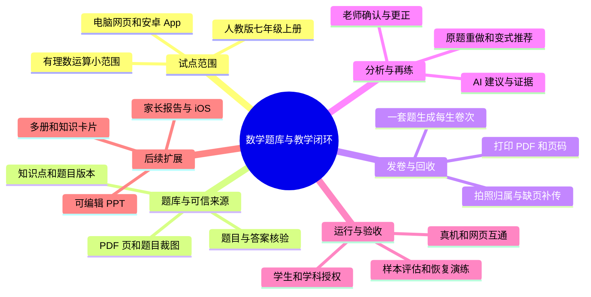
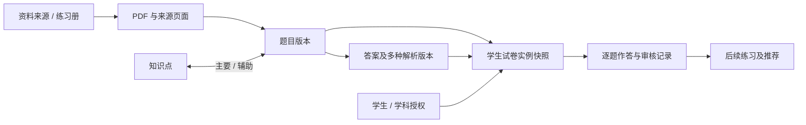
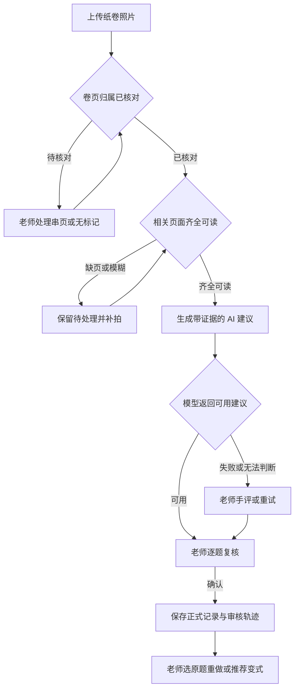
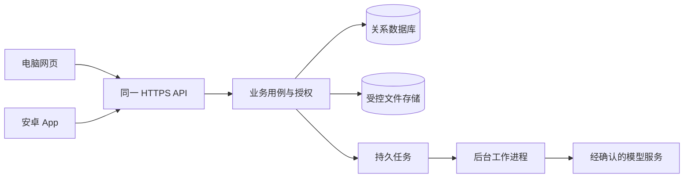
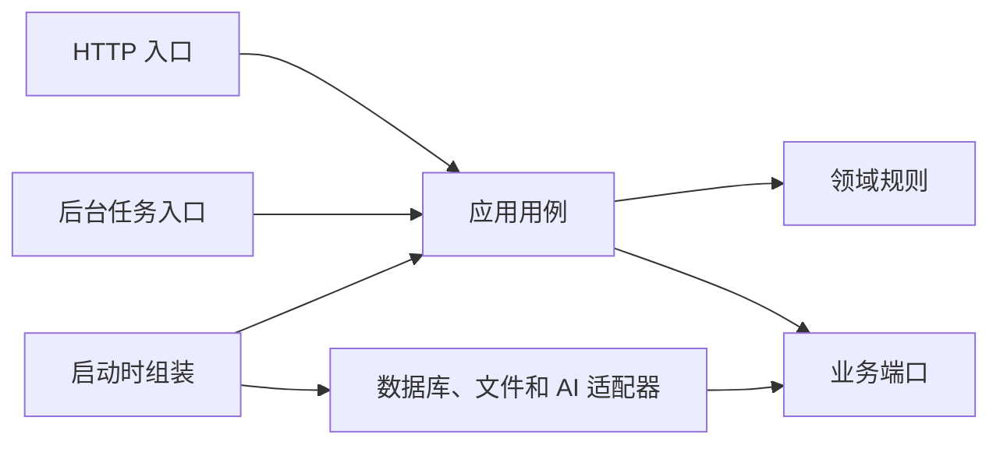

# 初中数学题库与教学系统完整需求与架构设计方案

完整方案 1.1 ｜ 2026-11-07

本方案为试点设计基线，供项目方、机构老师和负责人确认范围，并作为后续开发与验收依据。首版以有理数运算为起点，老师通过电脑网页和可安装的安卓 App 完成从题目核验、纸卷发放到批改复核和再练的教学闭环。架构和接口属于拟议设计，当前仍处于需求对齐与试点准备阶段。

访谈时使用配套工作手册记录真实案例、机构决策与验收约定。确认后的决定按需求编号回写本方案。 [教师访谈与机构定制工作手册](./初中数学题库与教学系统_教师访谈与机构定制工作手册.md)

## 目录

- [方案思维导图](#方案思维导图)
- [1. 项目目标与交付边界](#1-项目目标与交付边界)
- [2. 当前材料与使用前提](#2-当前材料与使用前提)
- [3. 从 PDF 到可以组卷的题目](#3-从-pdf-到可以组卷的题目)
- [4. 题目格式、知识点与数据库](#4-题目格式知识点与数据库)
- [5. 老师实际使用流程](#5-老师实际使用流程)
- [6. 功能需求与首版使用界面](#6-功能需求与首版使用界面)
- [7. 系统总体架构与长期演化](#7-系统总体架构与长期演化)
- [8. AI、OCR 与效果评估](#8-aiocr-与效果评估)
- [9. 身份、隐私和运行](#9-身份隐私和运行)
- [10. 技术选型与部署方案](#10-技术选型与部署方案)
- [11. 关键风险、前提与决策记录](#11-关键风险前提与决策记录)
- [12. 一至两周的试用计划](#12-一至两周的试用计划)
- [13. 首批验收：需要真实操作](#13-首批验收需要真实操作)
- [14. 后续扩展顺序](#14-后续扩展顺序)
- [15. 实施前需准备](#15-实施前需准备)
- [16. 资料依据](#16-资料依据)

## 方案思维导图



支持 Mermaid 的 Markdown 阅读器可以渲染此图。图中的分支对应第 1～2 节范围与材料、第 3～6 节题库和教学操作、第 7～11 节架构与风险、第 12～15 节实施和验收。 [Mermaid 思维导图语法](https://mermaid.js.org/syntax/mindmap.html)

## 1. 项目目标与交付边界

形成“老师讲解知识点 → 学生练习 → 收集作答 → 分析错误 → 老师确认 → 针对性复习和练习 → 持续跟踪”的闭环。初期资料和教学范围以**黑龙江省、人教版七年级上册数学**为起点。第一批面向机构内部，一名老师、约 100 名学生的使用场景；以后可扩展到约三名老师、300 名学生以及更多学科和用户。人数是初步场景，不是系统容量保证。

完整目标包括跨练习册题库、知识点及卡片、学生记录、AI 辅助、组卷、PPT、成长报告及未来学生和家长查看。首批一至两周试用的目标是**只围绕有理数运算的一个小范围，使用少量已核验的题目打通真实闭环**。不以扫描完 132 页作为试用前提；试用后扩至整册、整学期、七至九年级，再考虑其他学科。

首批包含：老师电脑网页端、可安装的安卓 App、老师和学生基本信息、单本练习册建档、题目录入与核验、知识点标签、查题选题、为单个或多个学生生成纸卷、拍卷上传与缺页提醒、AI 逐题分析建议、老师确认、练习记录、原题重做或推荐同类及综合题。老师最终决定。

苹果手机 App、知识卡片、可编辑 PPT 和面向家长的周报/月报在首批之后交付；首批建立清晰的知识点、题目与学生记录关联，未来据此扩展，而不为尚未确定的功能预做大量空接口。家长和学生账号、在线作答、跨机构开放也为后续能力。

### 1.1 需求的确认状态

| 状态 | 当前内容 | 确认依据 |
|---|---|---|
| 项目方已明确 | 有理数运算试点、网页与可安装安卓 App、正式组卷前核验、AI 建议由老师确认、历史记录可追溯 | 项目沟通记录 |
| 待机构确认 | 使用的具体页和题型、实际班级及人数、老师和管理员的职责、设备和网络、数据处理条件、试用及验收人员 | 教师访谈、机构负责人确认、设备清单和样本 |
| 设计提案 | 具体页面布局、标识方式、题目版本结构、技术候选和运维方式 | 小范围样板与架构决策记录 |
| 待试点验证 | OCR 与手写分析表现、复核用时、双端连通、文件恢复及一至两周目标 | 真实样本与设备的验收记录 |

后文用 REQ 编号追踪首版需求，用 AC 编号记录验收，用 DEC 编号记录机构决策。真实机构要求以填写后的记录为准。

## 2. 当前材料与使用前提

现有文件夹包含目录 2 页和习题 132 页，拆成四个习题 PDF。已抽看 8 页：存在选择、填空、解答、子问、数学符号、数轴、图表及几何图形。样本页已有文本层，但存在识别错误；不能把它当已校验数据。原始 PDF、页图、题目所在页和可供人工比对的题目裁图都应可追溯。跨页、跨文件的题目需人工核对；抽样并不能证明各页质量一致。

初期练习册来源由机构提供，参考答案需要另行扫描或拍照；长期希望老师还可增加其他练习册和自编题。资料复制、AI 处理、课堂发放与未来对外使用的范围，应随资料来源记录并由机构核实，不在此做法律结论。

### 2.1 现有资料入口

- 练习册扫描件位于 `C:/Users/19612/Desktop/七年级上册数学/`：一份两页目录，四份习题合计 132 页。以上质量判断来自 8 页抽查，并非逐页核验。
- 原有 [七年级上册图文资料](C:/Users/19612/Documents/Math/k12-reformatted/deliverables/七年级上册_图文排版.html) 是知识点讲解和可视化的早期参考，不默认为经过核验、可直接导入的题库。
- 参考答案尚需扫描或拍照；是否全部齐备、每题对应页码及实际录入工作量待核查。


## 3. 从 PDF 到可以组卷的题目

1. **建立来源**：记录学科、年级、学期、教材版本、练习册名称、版本、册别及来源文件。Number One 和 Number Two 是不同来源；老师可单选或多选来源，统一检索。
2. **拆页和定位**：保存原 PDF 和页码，在页图上定位题干、选项、图形、子问及共用材料。一个题目可对应多页；一张图可以被多个小问引用。
3. **识别候选**：使用 OCR / 多模态模型生成题目结构草稿，原有文本层仅是候选证据。标题、括号、符号、上标、分数、图形文字均需比对原图。
4. **答案及解析草稿**：记录纸质参考答案的扫描图和页码；AI 依据题目生成答案与完整解题过程。允许一题多个正确答案表达和多个解法。
5. **老师核验**：原图、识别内容、参考答案与 AI 解答并排展示；老师确认题干、图形、每个子问、答案、过程及知识点，必要时修正。AI 与参考答案不一致时，保留分歧和老师的最终判断。
6. **发布与检索**：仅老师确认过题目及其适用标准答案、解析的版本，才默认允许用于正式组卷和自动评分。若历史或特殊情况下未确认的题已发出，只能记为例外并由老师人工评分；不设置通常情况下绕开审核的出卷入口。

题目核验和答案核验分别保存。发布记录绑定该题的已核验题目版本、适用答案与解析版本、素材引用、经审核的知识点标签及审核记录。答案争议进入待处理，老师记录依据后再核准。更新已发布内容时形成新版本，旧卷继续引用当时的发布记录。

## 4. 题目格式、知识点与数据库

### 4.1 存储分工

- **原始 PDF、页图、题目图片、手写作业照片、生成的 PDF**：作为文件或对象保存，数据库记录其标识、用途和关联；不要只把文件路径写死在本机目录。
- **关系数据**：建议使用 PostgreSQL 保存学生、来源、题目、知识点、试卷、作答、审核状态和它们之间的关系，便于查询、约束和事务处理。
- **题目内容**：使用结构化 JSON 表示一题的文本、公式、选项、图片引用和子问；数据库中保留独立字段和关联，而不是把所有数据塞进一个大 JSON。JSON 是内容载体，不是唯一数据库。
- **公式**采用可编辑的 LaTeX 作为候选格式，保留原图。老师逐项核对公式结构、符号和渲染结果。公式或图形难以确认时保留原图和待处理标记，解决后再发布。后续 PPT 的公式可编辑性单独用实际文件验证。 [MathJax 的 TeX 输入支持](https://docs.mathjax.org/en/latest/input/tex/index.html)
- **图形**：先保存与原题对应的图片，支持定位和替换；未来若需要可编辑几何图，再单独研究结构化图形。
- **Markdown**：适合老师阅读或导出说明，也可以作为受控的文本内容格式，但单靠 Markdown 不足以表达来源、多对多知识点、答案审核、图片关系和学生历次作答。

中文关键词检索先围绕明确标签、来源、章节、题型、难度和简单文本匹配实现；中文分词、公式等价搜索和语义检索的效果需实测，不预设默认全文索引能正确理解全部数学表达，也不必第一天引入向量数据库。

### 4.2 核心对象及关系

| 对象 | 应保存的重点 | 为什么需要 |
|---|---|---|
| 学科、教材、来源 | 学科、学期、教材版本、练习册及文件 | 同一本册独立查，也能跨册选题 |
| 来源页与材料 | 文件及校验值、PDF 物理页序、印刷页码、页图、题目区域、共用图文 | 定位可复核的原题位置，支持跨页 |
| 章节和知识点 | 章节树、知识点名称与上下级、版本 | 章节来自教材或练习册；知识点可细分，二者不可简单当成同一张表 |
| 题目和题目版本 | 稳定题号、题型、题干、选项、子问、图片、难度、来源、审核状态 | 支持修改和追溯 |
| 题目—知识点关系 | 多对多、主要考查/辅助使用、审核人 | 一题可关联多个知识点；老师选择专项或综合 |
| 答案与解析版本 | 标准答案、多个解法、参考答案来源、核验结果、审核人 | 避免 AI 草稿与老师确认内容混淆 |
| 学生、老师、学科负责关系 | 学号、姓名、年级、学期及老师负责关系 | 基础资料共享，学习记录按负责学科授权 |
| 组卷模板、学生卷实例、页面 | 试卷模板、每人独立实例、页码/总页数、题目及答案版本快照 | 同题发多人也能正确对应；历史卷不随题库修改变化 |
| 作答与复核 | 每题或小问、每次尝试、照片版本、识别结果、答案结果、过程、口头观察、老师结论 | 区分空白、未收集和无法判断，保留教学判断的证据 |
| AI 建议和教师确认 | 模型与版本、输入证据、建议、老师修改、确认时间 | 未确认建议不直接成为正式结论 |
| 推荐和再次练习 | 推荐依据、原题/同类/综合、老师选择及后续结果 | 可追踪是否重复、是否进步 |

未来的知识卡片可与知识点关联，并按来源和版本维护。首批只需知识点实体和题目关联，不交付卡片编辑器。

### 4.3 单题结构示意

以下结构展示一条已核准发布记录的关键字段。样例标识为虚构值，发布状态由服务端从审核事实推导。

```json
{
  "question_id": "q-demo-001",
  "release_id": "rel-demo-001",
  "question_version_id": "qv-demo-001",
  "answer_version_id": "av-demo-001",
  "source_regions": [
    {"document_id": "doc-demo-001", "pdf_page": 8, "printed_page": "6", "region_id": "region-demo-001"}
  ],
  "type": "calculation",
  "content": [{"type": "text", "value": "计算："}, {"type": "math", "latex": "(-3)+5"}],
  "knowledge_points": [{"knowledge_point_id": "kp-demo-001", "role": "primary"}],
  "review_state": "approved"
}
```

实际建模保留小问标识、素材引用和审核记录，答案及多种解法随答案版本独立维护。区域标识关联页图、裁图坐标与来源，适合在核验和返工时定位。教材、章节、知识点和来源的名称可调整，业务关联使用稳定标识。

### 4.4 重要关系和版本规则



一题可以引用多个来源位置与知识点。跨页区域按文件、页号和裁图范围追溯，保留共享题干与小问之间的关联。跨册相似题各自保留来源，老师可以显式确认是否合并索引。发现已发布题目或答案有问题时，暂停用于新出卷，标记受影响的旧卷，再由老师按新版本作带原因的更正。

题目审核与答案审核分别记录；只有适用的题目版本和答案版本均获核准，才能组合为可用题。卷页二维码或标记只用于识别卷页，不携带姓名，也不能代替身份认证和权限校验。


## 5. 老师实际使用流程

### 5.1 出题和打印

老师选择来源、年级学期、章节、知识点、题型和难度；选择专项或包括综合题，查看原题及答案状态。老师从结果中自由选题、排序，形成一套练习。AI 可提供可解释的推荐，但不能绕过题目核验，老师保留增删权。

同一套题可分发给多个学生：每人生成独立的学生卷实例，卷面只显示学号、不显示姓名；每页标记试卷实例、页码及总页数，可用二维码或其他机器可读标记。打印效果必须检查公式、图形、分页、作答空白及标记可读性。历史卷应保存题目与答案版本；补打同一实例和新建一次练习应明确区分。

生成每生卷次时固定题序、小问、分值、题目及答案版本和排版模板。PDF 渲染成功后，登记页数和题区，再由老师预览发放。学生卷只呈现练习内容，答案及解析按授权供教师查看。补打沿用原卷次，新一轮练习生成新卷次。

### 5.2 拍卷、识别与老师审核

试点优先处理本系统生成、具备已知题区和卷页标识的纸卷。是否接收历史卷或外来卷由机构确认。遇到无法自动定位的卷，可由老师手动关联和录入，并在评估中标记为人工处理。

1. 上传一页或多页照片，使用卷页标记匹配学生卷及页次。无标记、标记模糊或和所选学生冲突时，进入待核对列表，由有权限的老师核对并记录改归属原因。
2. 按预期页数显示缺页、重复和画面不清。老师补传缺页或主动替换照片，替换保留旧版本与原因。同一卷次同一页的相同照片可重复提交，返回已有结果。同一照片出现在不同学生卷时提示核对归属。
3. 用当时的试卷版式定位各题。缺页表示缺少证据，遮挡和字迹不清表示待识别或人工处理。只有可核对的题区确实空白时，老师才可确认未作答。跨页题需收齐相关证据。
4. 模型提供识别文本、对错建议、过程、可能错因、知识点和证据定位。无法判断时标注原因并转给老师。模型服务失败时老师可继续人工复核或稍后重试。
5. 老师分别确认答案结果、过程得分或观察、口头理解与错因。可按机构评分规则记录部分得分，也可保留定性备注。AI 原始建议和老师结论分别保留。
6. 正式练习记录和后续报告只采信经老师确认的结果。单题错因属于一条观察，由老师结合多次作答与课堂情况判断知识点掌握程度。



### 5.3 后续练习和追踪

老师查看已确认的作答与薄弱点建议，选择：原题重做、同类新题、综合变化题。系统展示推荐理由、题目来源以及学生是否做过；重做是老师明确选择的行为，不应被一刀切的“去重”过滤掉。再次出题形成新的练习和作答记录，保留每次结果。

学生年级和学期可以更新；旧记录保留当时学习背景，不能随当前年级变化而被改写或丢失。

### 5.3.1 入学摸底与阶段变化

学生入学时，老师希望从题库中自行筛选题目，形成摸底练习，并保存当时的结果作为学习起点。首版可以先利用已有的老师选题、组卷和学生记录能力完成基础摸底；统一的能力划分、标准化评分及跨阶段比较规则，需要后续与老师共同设计和验证，不能预设已经具备。

后续周报、月报从宏观角度展示阶段分数、老师评语和学习建议，可根据经老师确认的记录总结变化；不要求向家长逐题列出学生不会的题。报告默认自动形成待审核草稿，老师确认后下载 PDF 发送；数据不足时不生成正式报告。

### 5.4 一个贯穿全程的例子

老师讲完有理数加减后，为五名学生从已核验题中挑选同一套题。系统生成五份分别标有学号的学生卷；老师打印后让学生作答。老师用安卓 App 拍摄其中一名学生的卷子，系统发现漏拍一页并提示补拍。

分析完成后，AI 提议第 3 题可能有负号错误，并给出相应知识点；老师对照卷面后把错误原因改为“漏算”，同时记录该学生“做题后讲不清楚”。老师确认后，正式练习记录才更新。下次老师选择同类新题，或者主动选择原题重做；两次结果分开保留。上述是设计场景，不是已经实现的功能。


## 6. 功能需求与首版使用界面

以下为项目方明确的试点范围及后续目标。具体使用方式、设备、样本和验收条件通过教师访谈落实。

| 功能 | 首版：有理数运算小范围试用 | 后续完整目标 |
|---|---|---|
| 老师端 | 电脑网页与可安装安卓 App，两个入口共享同一份数据并能完成闭环 | iOS App；根据老师反馈完善交互 |
| 题目来源 | 一册练习册、选定页面、可追溯原图；参考答案可上传 | 多册分来源管理；单册或跨册检索，自编题 |
| 题目检索 | 知识点、章节、题型、难度等可用字段；老师选择专项或包括综合题 | 更多版本、学期和来源筛选；资料具备时按预计用时筛选，按样本改进搜索与推荐 |
| 核验 | 老师对照原题和参考答案核验题目、答案与过程。数据允许保存多种解法 | 丰富多解编辑和比较体验，增加批量辅助评审 |
| 组卷与打印 | 自由选题和排序，同卷多人或单人个性化，每人独立卷次；生成带学号 PDF | 丰富排版模板和试卷类型 |
| 拍卷与分析 | 安卓拍照或选图、上传多页、检查缺页，AI 给出逐题识别、对错、过程、错因与知识点建议 | 在实际测评基础上提高识别效果与工作效率 |
| 教师复核和学生记录 | 老师核对并确认；保存每题对错、未做、过程、口头理解及每次练习结果 | 更完整的学习画像和多学科记录 |
| 再次练习 | 老师可选原题重做、同类新题或综合题；AI 推荐须由老师确认 | 根据更多经确认的学习记录改进推荐 |
| 知识点卡片 | 建立知识点及题目关联；不交付完整卡片编辑或可视化系统 | 根据教材和老师资料制作精华卡，老师审核后打印、课后复习，逐步增加可视化 |
| 课件 | 不作为首版交付 | 根据选题生成可编辑 PPT；题目文字、公式可修改，图片可移动或替换，并支持答案；以后再扩展讲解和备注 |
| 家长报告 | 保留可追溯、经老师确认的记录；不交付完整家长报告 | 周报/月报自动生成待审核草稿，老师确认后下载 PDF 发送；数据不足不生成正式报告 |
| 学生、家长 | 暂由机构老师使用 | 学生在线作答、学生/家长查看等另行设计 |

首版首先缩小**章节、题型或已核验题数**，而非取消安卓 App、网页、AI 分析或老师确认。具体首批题数以老师能完成核验且覆盖闭环为准，当前尚未确定。

### 6.1 老师可操作的页面和动作

1. **登录及学生**：老师登录，查看有权限的学生，选择姓名或学号，查看年级及已有学习记录。机构管理员维护老师、学生及学科负责关系。
2. **资料入库及核验**：上传 PDF 和参考答案扫描件，查看原图与识别草稿；确认题干、公式、选项、图形、答案、解题过程和知识点。手机与网页端的布局可不同，但不得绕开审核规则。
3. **找题与组卷**：选择一本练习册、章节、知识点、题型、难度及是否包含综合题；查看 AI 推荐和理由，老师自行增删与排序。生成后可为一人或多人创建各自试卷并打印。
4. **拍照上传**：安卓 App 能调用相机或从相册选图，展示页次与缺页信息，支持补拍；网页端也可上传已有图片。无法识别卷页时由老师处理。
5. **分析及复核**：按学生、试卷、题号浏览原始照片与 AI 候选，修改对错、过程、错因、知识点及课堂观察；确认后保存，待处理内容有明确提示。
6. **再次练习与历史**：查看确认后的错题、是否重做及结果；选择原题、同类或综合题，形成新卷。更新学生年级/学期时，旧记录保留其当时背景。

### 6.2 首版的明确规则

- 题目内容与答案/解析分别审查，必须均已核准后才进入正常正式出卷和自动评分。AI 草稿与纸质答案冲突时，由老师判断并记录。
- 已经出现的历史例外题只能由老师人工评分并留痕；这不等于提供平时绕开核验的出卷方式。
- 单题支持多个解法；一道题或多个小问可关联多个知识点，标明主要考查和辅助使用。
- 老师可以记录“做对但讲不清”“结果错误但部分过程正确”，不把结果、过程与口头理解混成一个字段。
- 成绩和能力报告的测评规则尚未由老师确定，不能先假设不同难度、不同题量的考试分数可直接比较。

### 6.3 首版需求与验收索引

| 编号 | 老师或机构需要完成的事 | 对应验收 |
|---|---|---|
| REQ-01 | 根据原图与参考答案核验题目、答案和解析，检索已发布的题 | AC-01 |
| REQ-02 | 组题、为多人生成独立卷次并打印，能查回当时的版本 | AC-02 |
| REQ-03 | 上传纸卷、确认归属、处理错配或缺页，保留补拍历史 | AC-03 |
| REQ-04 | 获取带证据的 AI 建议，老师确认、改判或人工处理 | AC-04、AC-09 |
| REQ-05 | 查看同一学生的历史和本次记录，按老师选择安排下一次练习 | AC-05 |
| REQ-06 | 网页和可安装安卓 App 完成同一教学闭环，数据一致 | AC-06 |
| REQ-07 | 按机构、学生与学科保护学情及附件，按确认条件处理样本 | AC-07 |
| REQ-08 | 在机构环境可运行，文件和数据库能一并备份恢复 | AC-08 |

## 7. 系统总体架构与长期演化

### 7.1 设计依据与总体原则

本章结合 [《架构 × Vibe：从基础词到 AI 也必须遵守的规则（v4）》](C:/Users/19612/Desktop/architecture-vibe-guide-v4.html)，将其中的依赖方向、端口与适配器、深模块、信息隐藏、质量属性场景和 AI 开发护栏，落实到本项目。指南中的建议需要根据当前项目规模取舍；以下为**拟采用的架构设计，不表示已有代码、接口或测试**。

本设计围绕长期维护和真实教学，回答以下问题：

1. 哪些业务规则长期必须成立，谁负责执行？
2. 功能如何按业务变化划分，模块能看到彼此什么内容？
3. 更换模型、加一本练习册、增加一门学科时，哪些地方允许变化？
4. AI 写代码、任务重复执行、供应商失败时，怎样防止架构和教学记录被破坏？
5. 如何用能实际运行的检查，验证这些承诺，而不是只保留一张图？

**教师终端要求**：首批同时交付老师可使用的电脑网页端与**可安装的安卓 App**，后续再支持苹果手机。不是仅用手机浏览器适配来替代 App。手机端与网页端共用后端业务用例和权限，至少支持同一教学闭环；手机尤其需要可靠拍照、选图、上传、查看分析与老师确认，页面布局可因设备不同而调整。操作是否完全一致以后以老师试用反馈细化。

### 7.2 业务不变量：所有入口都必须遵守

无论来自老师网页、首版安卓 App、未来的其他客户端、AI 代理还是后台任务，以下规则都由服务端业务用例执行，不能只靠页面按钮控制：

| 编号 | 不变量 | 发生变化或错误时的处理 |
|---|---|---|
| R1 | 题目和适用的标准答案/解析经过老师核准，才能进入正常正式出卷和自动评分。 | 未核验或有争议时拒绝，并指出原因；已经发出的历史例外只能人工评分并留痕。 |
| R2 | 一张已发出的学生卷必须能追溯当时的题目、答案和版面版本。 | 题库后来修订不能静默改写旧卷；发现旧题有错，可发出风险提示并由老师复核，保留历史。 |
| R3 | AI 判断是建议；老师确认前，不产生正式的教师确认作答或掌握结论，也不进入正式家长报告。 | 无法判断、看不清、缺少证据或分歧时等待老师处理；AI 重跑或迟到结果只能形成新建议。 |
| R4 | 同一套题可给多人，但每次学生练习与照片、页码和作答必须对应到正确学生卷。 | 页面、学生或题号无法确定时进入待核对，不凭猜测归档；漏页可补传。 |
| R5 | 已确认作答与老师修订需要保留证据及历史；重复提交不能制造多条相同的确认。 | 并发修改需提示冲突并重新确认；更正产生可追溯的新记录，不抹掉原始 AI 建议。 |
| R6 | 被分配同一学生的老师可访问基础资料；学习记录按教师负责的学科与学生范围授权。 | 后端核对权限；未授权请求不能通过换一个页面或接口绕过。 |

这些规则与第 3～6、9 节的业务要求相互对应。上表针对首版明确的原则，不预设将来的所有评分、知识掌握标准或学生权限细节。

### 7.3 从“哪里容易变化”划分模块

按需要一起变化的业务决策组织代码，而不是每个数据库表、按钮或 AI 调用单独建一个模块。首版可在同一个后端应用中实现，模块名仅为规划示意。

| 业务模块 | 它负责并隐藏什么 | 对其他模块提供的能力 | 首版与以后 |
|---|---|---|---|
| **资料与题库** `catalog` | 练习册和来源页、题目及答案版本、核验发布、题目版本关联的主考及辅助标签 | 查询已核准题目与发布版本，核验、发布或停用题目，提供练习所需快照 | 首版做有理数运算，后续加多册、自编题和其他学科 |
| **知识体系** `knowledge` | 教材章节、标准知识点字典及层级，维护教材与知识点映射 | 查询知识点标识及教材映射，供题库使用 | 首版有知识点标签，卡片、可视化和教材知识内容后续增加 |
| **身份与授权** `identity` | 老师、学生基础资料、学科与负责关系；隐藏身份映射和授权细节 | 校验当前操作者能否访问某学生及学科；返回授权范围内的基础资料 | 首版即执行；多机构隔离需另行设计和验证 |
| **练习与确认** `practice` | 组卷、每生卷次、版本快照、页面、作答、老师审核及历史；隐藏练习状态转换 | 创建练习、接收页面、确认作答、查询学生练习记录 | 首版必须完整；未来扩展在线作答 |
| **分析与推荐** `analysis` | 识别和分析任务、AI 候选、证据、模型调用信息，以及推荐依据；隐藏供应商输出差异 | 请求分析、获取待审核建议、根据已确认记录给出候选题 | 首版产生建议并供老师检查；不拥有老师最终结论 |
| **呈现与导出** `delivery` | 面向使用者的网页和 App 接口、纸卷呈现与导出适配；隐藏排版实现 | 读取被授权的题目及试卷数据，生成 PDF；以后提供 PPT、报告展示 | 首版支持网页、安卓 App 和 PDF；PPT、知识卡和报告后续增加 |

模块可以在实际设计时合并或调整，但每项业务事实应有明确的维护者。不同模块通过公开的应用用例或简单的数据契约协作；不得直接改写其他模块的私有数据表，不以导入对方内部实现作为捷径。跨模块列表和统计允许通过经授权的只读查询接口或受控查询视图一次获取必要数据，不要求把每一行都还原成复杂对象。禁止模块互相循环依赖；共享类型只放真正稳定的少量公共概念，不建立包揽所有事情的 `common` 或 `utils`。

知识点本身与练习册章节不是同一个概念：例如两本练习册把同一知识点安排在不同章节；题目可从不同来源关联同一个知识点，检索时由老师决定单册或跨册。未来知识卡、PPT、报告依据已发布的业务数据建立自己的呈现，不反过来控制题目是否合格。

### 7.4 运行连接与源码依赖

运行时，网页和安卓 App 访问同一服务。后台工作进程通过业务用例领取任务，由适配器访问文件、数据库及经机构确认的外部模型。



源码依赖另行约束。下图中箭头指向代码所依赖的接口或模块。



- 领域层表达业务概念和不变量，例如“未核准答案的题不能正式出卷”。应用层组织一次完整工作，例如“老师确认作答”。二者不导入 Web 请求类型、ORM 数据行、数据库连接、React 类型或具体模型 SDK。
- HTTP、数据库、文件和模型适配器负责把各自格式转换为业务可理解的数据；跨边界传明确的业务输入和结果，不把供应商原始响应或 ORM 行当作领域模型。
- **组合根**是外层装配位置：根据运行配置把实际存储、模型和时钟等实现交给应用用例。网页、安卓 App 和后台入口使用同一组业务用例，AI 代理未来也必须走授权过的用例，不能直写数据库。
- 在领域模块内部不强制每个函数拆成四层。只有涉及稳定业务策略与易变外部机制时，才建立清楚的边界；避免空接口、一比一透传和大量无业务意义的小类。

### 7.5 一个完整例子：老师确认 AI 对第 3 题的分析

假设 AI 建议：“结果错误，可能在负号运算时出错”。老师改成“结果错误，但错因是漏算”，再点击确认：

1. **入口层**接收学生卷、题目版本、AI 建议版本、老师的结论和本次操作标识，做格式检查；不在页面或控制器里自行决定是否能确认。
2. **身份与授权**核查老师是否负责该学生的数学记录。练习用例再核对学生卷、题目与答案版本、照片版本和复核版本。
3. 同一操作键与相同内容重放时返回原结果。相同操作键附带不同内容，或提交基于已变化的复核版本时，服务端拒绝并提示重新查看。
4. 在同一数据库事务内保存老师结论、审核轨迹、状态及必要的待处理记录。AI 原建议与证据单独保留。
5. 提交成功后，学生历史展示该老师确认的内容。换图后生成新的待复核记录。迟到结果只归档到原输入，已经确认的记录需要经老师另行更正。

创建学生卷时，服务端在同一事务或等效并发控制下核准题目发布记录、冻结题序和版本、创建独立卷次。后台渲染完成后登记 PDF 与题区清单，状态才变为可打印。正式发放前检查相关发布记录是否已因错误停用，渲染失败或发现争议时提示老师重新选题或核验。

### 7.6 端口与适配器：只在值得隔离的地方设接头

端口由使用它的业务用例根据自身需要定义，名称表达业务能力，而不是供应商名称；适配器把数据库、文件和外部服务的语言翻译到该能力。下表是第一批可能需要的边界，最终以首个可运行纵向切片验证后定稿：

| 端口示意 | 输入及输出语义 | 需要明确的失败行为 |
|---|---|---|
| `题目核准快照读取` | 指定题目版本，返回已核准题干、答案及必要素材引用 | 不存在、未核准、已停用或版本不一致，返回可识别原因 |
| `学生作答分析` | 已核准题目/答案版本、题目区域或作答图片引用、业务配置 → 结构化建议、证据与不确定项 | 超时、服务不可用、格式不合法、内容看不清；不得伪装成“学生做错” |
| `作业照片与文件存储` | 保存/读取经授权的文件及其稳定标识；可实现本地或云端 | 上传中断、读取失败、权限不足；需有清理或补偿策略 |
| `任务执行与状态` | 提交一次可追踪任务，查询状态、重试或人工终止 | 使用业务任务标识及幂等规则，不能因重试重复确认或串学生 |

这些名称、输入输出和错误属于设计草案，不是现有 API。老师确认作答、正式出卷等是应用用例，不能把真正的业务决定委托给供应商适配器。

例如替换 OCR 或多模态模型时，应优先把变化控制在供应商适配器、配置、提示映射、测试和评估材料；若能力或数据契约确实不同，应评估必要的其他调整；**题目审核、学生授权和确认规则不得因此绕过**。同一端口的不同实现需要通过同一套契约检查及真实样本评估；接口相同不代表识别质量、时延或收费相同。

Jev 是可评估的一种评审适配器，不是题目正确性的最终裁判。其输出类型、分数和错误状态需按实际服务接口处理；分数不是经本项目验证的正确率，不能让高分自动取代老师核验。

### 7.7 AI、异步任务与数据一致性

**任务边界。** 题目识别、答案生成、作业分析分别保存：任务标识、关联的来源/学生卷及版本、输入引用、模型和提示配置版本、状态、输出候选、错误、老师修改与确认结果。敏感内容如何记录应受权限和最小必要原则约束，不要求把完整学生照片或提示词无条件写入日志。模型建议不直接写成正式题目答案或教师结论。

### 7.7.1 状态与更正规则

| 对象 | 状态示意 | 更新规则 |
|---|---|---|
| 学生卷 | 待渲染、可打印、已发放、作废 | PDF 与题区清单齐全后可打印，老师确认发放后开始收卷。作废保留历史并停止接收新作答 |
| 卷页采集 | 缺页、待核对、可用 | 归属确定且可读后可分析。每次显式换图产生新照片版本 |
| AI 任务 | 待执行、执行中、已完成、失败 | 任务绑定卷页与输入版本。超时重试、失败和用量可查 |
| AI 建议 | 待复核、已采纳或修改、驳回、已过期 | 输入变化后旧建议过期，保留可追溯的审核历史 |
| 老师记录 | 待处理、已确认、已更正 | 只有老师提交确认才形成正式结论。更正保留旧结果与原因 |

同一学生卷页号可以有多个照片版本，当前版本只有一个。补拍替换或错卷改归属使相关待审核分析过期。对已确认结果，先标出受影响范围并转交老师，老师核对后登记带原因的更正。

**事务与外部调用。** 数据库中一次确认操作的事实和状态必须在同一事务提交；不要在长时间数据库事务内等待外部模型。后台任务记录需可恢复，重复上传、重复回调和重试以稳定任务或操作标识去重；崩溃后能安全地重新领取任务。第三方模型可能已经执行但本地未收到结果，因此不能声称外部调用严格“只执行一次”，要防止它多次改写本地业务事实并控制重复费用。

**文件与数据库。** 文件和数据库不共享天然事务。约定先持久化文件或临时文件、核实成功后登记引用；任何一步失败时保留可恢复状态，并安排无引用临时文件的延迟清理。涉及删除时先核对引用与保留规则。上述为目标流程，具体实现须用故障注入和恢复演练验证。

**供应商边界。** 机构确认处理条件后，服务端按最小必要范围传入题目与作答裁片，使用随机任务标识。姓名、学号、联系方式及整页照片默认留在机构授权的环境。遇到手写姓名等无法可靠去除的标识，转老师人工处理。试用期间为模型调用设置重试上限和费用额度。

### 7.8 推荐代码组织：按业务组织，在业务内分层

```text
project/                         # 以下为建议，不代表文件已存在
  web/                           # 老师电脑网页
  mobile/                        # 老师 App：安卓先行，苹果后续
  backend/
    catalog/                     # 来源、题目、答案与审核
      domain/  application/  adapters/
    knowledge/                   # 章节与知识点
    identity/                    # 身份与授权
    practice/                    # 组卷、学生卷、作答、教师确认
    analysis/                    # AI 候选与推荐
    delivery/                    # 输出与界面适配
    bootstrap/                   # 组合根、服务启动
  tests/                         # 业务、契约、结构、集成和端到端检查
  docs/architecture/             # 架构地图、决策记录、质量场景
  AGENTS.md                      # AI 开发的短地图与强约束
```

不是每个目录一开始都要创建，也不强制每个模块拥有完整分层。典型目录命名、语言、技术选型和依赖检查工具，在项目实际创建时结合实现确定。避免把所有业务堆入一个 `services.py`，也避免为每个字段建立独立类。

**安卓 App 的实现与连接。** 可考虑 Flutter 或 React Native 构建可安装应用，具体技术待检查本机开发环境、相机/文件能力和开发效率后确定；Flutter 官方支持 Android 与 iOS，但以后增加 iOS 仍需对应工具链、签名及真实设备测试，不能保证零修改或自动交付。参考：[Flutter 支持的平台](https://docs.flutter.dev/reference/supported-platforms)、[Flutter 平台工具链](https://docs.flutter.dev/platform-integration)。电脑网页和 App 可以使用不同 UI 技术，通过同一版本化后端接口访问数据，不在两端各自实现一套放行、权限和学生结论规则。

首批手机操作至少包括老师登录、查找学生和已核验题目、选题/组卷或接续已创建卷次、拍照或选择图片上传、检查漏页、查看 AI 候选、逐题修改确认、查看已确认记录及再次选题；导出和打印以可访问生成的 PDF 为准。界面和实现顺序应结合实际操作打磨，完整闭环以安卓真机和电脑网页均可完成为验收目标。

服务若暂运行在老师电脑上，手机需要在经允许的同一网络中访问该服务：规划可用地址、登录、传输保护与设备连接，不能把电脑上的 `localhost` 当成手机可访问地址，也不能为省事关闭身份验证或将服务无控制地公开到互联网。局域网设置、证书与具体设备可行性须实测；云端方案另按实际网络条件选择。上传中断应显示状态、允许安全重试并防止重复记录，不承诺离线处理。

安卓试用包需要构建、签名、安装及更新方式，并妥善管理签名密钥；后续 iOS 的设备、开发工具、签名和发布安排单独验证。首版测试至少使用一台老师实际使用的安卓真机，核对登录、相机权限、拍照/相册、上传中断、图片方向、清晰度、系统权限拒绝后的提示与恢复，以及多页试卷复核。Web 和 App 两端同一账号的结果一致性也要测试。

### 7.9 面向 AI 开发的护栏：让约定可以检查

本项目计划大量使用 AI 写代码，因此在写第一个正式功能时建立最小工程资产，而不是仅在提示词里说“请遵守架构”：

1. **短项目地图 `AGENTS.md`**：记录目标、模块入口、必须遵守的 R1～R6、最小验证命令及指向详细文档的链接；具体内容由实际仓库与实现确认，不覆盖用户已有指令。
2. **架构与决策记录**：保存模块职责、允许依赖方向、实际取舍和修改原因。每一项重要决定写明背景、候选方案、取舍、触发重新评估的条件。
3. **先做一条端到端范例**：以“题目核准 → 组卷 → 上传 → AI 建议 → 老师确认”中的一条真实小流程展示目录、端口、错误与测试写法，之后让 AI 按已验证范例扩展。
4. **自动结构检查**：禁止领域/应用核心导入指定框架或供应商 SDK；检查禁止的跨模块内部依赖和循环。报错必须告诉开发者哪里违规、应该依赖哪个公开接口。检查工具与规则要按实际语言实现，不能把本文伪代码算作已通过。
5. **任务切片与完成条件**：每次任务写目标、涉及文件/领域、禁止越界的规则、验收例子和应运行的检查；让 AI 先查询现有接口和规范，不自造事实或未经验证宣称成功。
6. **代码审查**：重点审查授权、未核验出卷、历史快照、重复任务和 AI 结果覆盖，而不是只看代码是否能运行。

开发检查应在本机及持续集成中运行，检查配置、命令和通过结果要以实际仓库为准。首版先实现关键规则；已有项目若后来加入，可先建立问题基线并逐步收紧，不以大量无关告警阻塞开发。

### 7.10 可验证的质量场景与演化触发点

下表是建议的验收场景，不是已测指标；数字和样本量由老师与开发者在试用时确认，任何时间或准确率指标要记录环境、样本和结果。

| 未来变化或故障 | 期望响应 | 验证方法 |
|---|---|---|
| 增加 Number Two 并与 Number One 混合组卷 | 新来源可以映射已有知识点，原有学生记录和卷次不被改写 | 两本样本入库，单册/跨册查询及历史卷回放测试 |
| 更换 OCR 或作答分析供应商 | 通过业务端口接入，不改题目核准和老师确认规则 | 同套成功、超时、格式错误、重复结果契约测试，加老师标注样本对比 |
| 同卷给两名学生且一份漏页 | 卷次独立；提示缺页，可补拍；任何结果不串学生 | 真实打印、错序上传、漏页、重复上传及手动纠错测试 |
| 未核验答案被请求出卷，或 AI 建议直接更新正式记录 | 服务端拒绝并给出可操作原因 | 页面、直接 API、后台入口分别验证；未授权无法绕过 |
| 题库修改后查看旧卷 | 历史题目/答案版本仍可还原；已知错误能被提示 | 建卷后改题和答案，再比较旧卷与新卷快照 |
| 两位老师并发确认同题 | 不静默覆盖；有版本冲突提示和审核历史 | 模拟并发及重复点击；核查最终记录和轨迹 |
| 电脑损坏或迁移云端 | 数据库与文件能一起恢复；恢复后的记录可追溯 | 制作备份并在独立环境恢复，校验数量、文件校验值及关键业务；恢复时间和可丢失数据窗口待试用约定 |
| 老师用安卓 App 拍照、又在电脑网页复核 | 登录权限、卷次和分析结果一致；网络中断可安全重试 | 真机安装、拍照、传输中断重试、多页上传，网页与 App 对照同一学生记录 |

结构性信号包括循环依赖、一次需求横跨多少模块、自动检查速度、老师复核耗时和模型错误样本；它们用于发现问题，不作为脱离场景的绩效指标。性能和并发目标需要先测实际使用量，不能仅凭预计 100 或 300 名学生推断。

**迁移到云端的最低步骤**：冻结或受控暂停写入 → 一致性备份数据库及文件 → 在新环境恢复并比对记录数、文件校验值和权限 → 用真实但受控的用例验证 → 再切换访问入口。保留回退方案；切换后若已产生新写入，回退必须先处理这些增量，不能直接用旧备份覆盖。全过程需演练，不能只复制数据库或只复制图片。

**何时重新评估架构**：跨模块需求反复造成大量联动修改、同一模块有明确独立扩容/部署需求、实际任务并发和资源竞争影响体验、团队拥有独立维护边界时，先测量瓶颈，再决定是否拆服务或增加消息组件；在此之前保持模块化单体。新增其他学科时先用真实题型、过程与权限验证边界，不声称当前数学模型天然覆盖所有学科。

### 7.11 首批落地和后续设计的边界

**首批必须兑现**：电脑网页、可安装安卓 App、一个练习册和小范围核验题、学生与学科授权、版本化学生卷、纸卷页面匹配、AI 建议、老师确认、记录、重新选题；再加关键业务规则测试、至少一个供应商边界契约测试、依赖方向检查和一次备份恢复演练。任务的核心流程和真实用例验收仍以第 12～13 节为准。

**后续逐步补充**：第二本书、知识点卡与可视化、可编辑 PPT、家长报告、在线作答和其他学科。届时为实际需求新增端口与契约；不提前搭建空的插件市场、微服务群、复杂消息平台或各种未来账号系统。

**尚未决定**：网页和 App 的具体框架及版本、安卓试用机型与安装渠道、部署地点、OCR/多模态供应商、备份恢复目标数值、姓名遮挡方式以及按学科扩展时的详细权限，均需结合真实试用与服务条件确认。候选框架的功能说明参见第 16 节；任何接口、路径和指标在落地前均属示意。

## 8. AI、OCR 与效果评估

### 8.1 每类 AI 的职责

| 环节 | 提供的帮助 | 老师或系统最终责任 |
|---|---|---|
| PDF 识别 | 识别文字、公式、选项与题目边界，并定位图片 | 老师对照来源页核对；扫描层或 OCR 结果都只是候选 |
| 答案与解析 | 根据题目生成答案、完整过程和其他可能解法 | 老师对照参考答案、检查过程并确认或驳回 |
| 知识点标注 | 建议涉及的知识点、主考/辅助及专项/综合属性 | 老师修改并确认，不能把综合题强行归到一个知识点 |
| 手写作业分析 | 读取题目区域及作答，提出结果、过程、错因与证据 | 看不清、判断不出或有分歧时交老师；最终记录以老师确认为准 |
| 练习推荐 | 根据确认的错题、知识点及已做题提出原题、同类或综合候选 | 老师决定选哪些题、是否重做及什么时候练 |
| 评审辅助 | 使用 Jev 或其他适配器，针对明确标准评估候选内容 | 结果不等于事实或正确率；模型/服务仍需真实样本验证 |

AI 输出至少应能够记录关联对象与版本、输入证据引用、模型及必要配置版本、建议内容、不确定点和生成时间；正式结论与老师修改另行保存。任务日志不要默认包含完整学生照片、姓名和密钥。模型分析失败时显示原因并允许安全重试或人工处理，不能把失败当作学生做错。

### 8.2 试点效果怎么评估

由老师为获准使用的样本标注参考结果。条件允许时，将用于调整模型的样本与用于验证的样本分开。按卷页匹配、题区切分、手写和公式识别、判分、错因、推荐分别记录分子与分母。

| 指标 | 记录方法 |
|---|---|
| 正确归属 | 自动或人工确认的正确页数 / 参考归属明确的页数，另列待核对、错配、漏页和重复页 |
| 建议覆盖与弃判 | 分别记录产生可复核建议、模型主动弃判、任务失败的数量，以符合分析前提的题数为分母。缺页、无法归属和待收集另列 |
| 批改正确性 | 对照老师逐题参考结果，分别记录正确、错误、部分正确和未作答。重点统计被误判为正确的错误题数 / 老师标注的错误题数 |
| 建议质量 | 分开统计老师认可的错因、知识点和推荐，保留老师改判及理由 |
| 老师用时 | 同类型、同量级样本对比现行做法与试用流程，记录取图、复核和处理异常的用时 |

样本记录包含题型、题数、覆盖到的负号、分数、图形、遮挡等情况、老师、设备与模型版本。质量门槛和样本量由机构在试点前确认。模型自报信心供复核参考。样本不足时报告已观察的结果、例数与适用范围。出现串学生、越权读取或审核记录静默改写时，按第 13 节的试用放行条件处理。

### 8.3 如何更换服务

OCR、解题、多模态和评审服务通过业务端口与适配器接入；更换时检查功能差异、数据使用条件、成本、接口映射和提示配置，执行同一批契约测试及老师标注的真实样本对比。目标是保持核心业务规则稳定；如果新服务能力或契约确实变化，仍可能需要相应调整及影响评估。

## 9. 身份、隐私和运行

### 9.1 权限与分工

| 角色 | 允许处理的对象 | 授权条件 |
|---|---|---|
| 机构管理员 | 机构内的老师、学生基础资料和负责关系 | 默认负责维护授权，查阅学情和原图需单独授权 |
| 任课老师 | 负责学生的姓名、年级和学号，及负责学科的试卷、照片、复核、记录与导出 | 同时核对机构、学生和学科。不同学科老师可共享同一学生的基础资料 |
| 题库审核人员 | 本机构获授权的练习册、题目、参考答案、解析及发布动作 | 可与任课老师为同一人，由机构明确责任 |
| 后台任务 | 本次任务所需的具体输入及候选结果 | 按服务身份与任务范围运行，沿用机构授权与数据处理条件 |

服务端对列表、详情、图片、PDF、任务和导出执行同一权限判定。链接、二维码、请求中的学生标识或客户端缓存都不能授权访问。撤销分配或停用账号后验证访问失效，已生成链接和下载权限按短期或可撤销策略设计。

### 9.2 数据处理和留存

试点前由机构记录允许使用的题源、学生数据、授权人员、模型供应商及处理条件。尚未确认时使用合成或获准的去标识样本。学号可关联学生，手写照片还可能包含姓名。外发前提供裁切、遮挡与老师复核的入口，按第 7.7 节最小范围传送。服务密钥保存在服务端。

机构分别确定原卷、裁图、作答记录、报告草稿、导出文件和日志的留存期限及删除责任人。撤回或到期时处理活动数据、导出链接和到期备份，记录处理结果。审计保留操作时间、操作者、业务标识和必要结果，限制敏感原图与正文进入日志。

### 9.3 备份与恢复

由机构指定负责人及恢复目标。建立同一恢复点的数据库和文件备份，必要时短暂停写，核对文件引用和校验值。在独立环境关闭外部模型调用，恢复后抽查题目、学生卷、照片、老师确认记录及权限。记录恢复用时、恢复点和错误，试点时由机构确认可以接受的数据丢失窗口与停机时间。

## 10. 技术选型与部署方案

以下为实施前的建议和候选项，实际版本、供应商和费用需在开发前核对，不能视为现成环境。

| 位置 | 建议或候选 | 选择原因和需要验证的内容 |
|---|---|---|
| 电脑网页 | React 或 Vue 等网页技术，具体待定 | 需要题目核验、组卷、学生记录与老师复核；与 App 共用服务端业务规则 |
| 安卓 App | Flutter 或 React Native 等可安装应用技术，具体待定 | 首批必须真机安装并支持拍照、选图、上传和复核；以后增加 iOS 需另做工具链、签名、兼容与真机测试 |
| 后端 API | Python + FastAPI 为候选；采用按业务划分的模块化单体 | 便于与文档、图像、AI 处理联动；框架在外层，应用规则不依赖其请求对象 |
| 数据库 | PostgreSQL 为候选 | 管理来源、题目、学生、卷次、审核、版本与它们的关系；迁移和备份需演练 |
| 文件与图片 | 初期本地文件存储，后期可迁对象存储 | 保留原 PDF、页面、裁图、参考答案、作业照片和导出件；数据库只引用稳定标识及元数据 |
| 数学展示 | 公式保存为可编辑 LaTeX 候选，网页可采用 MathJax；图形先作为图片 | 需核对特殊符号、版式与数学正确性；不自动保证 PPT 原生可编辑 |
| OCR 和 AI | 先以真实样本比较可用服务；Jev 是可测的评审候选 | 需同时考量效果、服务可访问性、费用、保留及处理条件，任何一家失败均有人工复核路径 |

### 10.1 首版部署

老师可先在机构电脑部署后端、数据库、文件和网页，安卓手机通过安全可访问的局域网地址连接；手机不能直接用电脑自己的 `localhost`。启动前验证身份认证、传输保护、网络可达、相机权限和 App 安装更新方式；不要为了方便将数据服务直接无控制暴露到公网。上云时间、部署商、域名和预算尚未确定。

安卓试用至少需要可安装的构建包、试用真机、签名及可恢复的密钥管理。局域网连接、断网后安全重试、图片方向和清晰度、Web/App 同一条记录的同步效果，均须真机实测；首版未承诺离线运行。日后迁移云端要同步迁移数据库和文件并进行恢复验证，不能只复制其中一种数据。

### 10.2 接口及数据约定

以下为拟议的业务契约，具体路由、字段和响应格式在纵向样板中定稿。网页和 App 通过同一服务端业务入口操作。

| 操作 | 主要输入 | 返回和可处理结果 |
|---|---|---|
| 核验发布题目 | 题目及答案版本、来源和老师确认 | 返回发布记录。版本冲突或未核验时返回待处理原因 |
| 创建并发放学生卷 | 已核准发布标识、学生、题序、模板及操作键 | 创建独立卷次。可查询 PDF 渲染状态。老师确认后登记发放 |
| 上传或替换卷页 | 学生卷、页号、文件及操作键。替换时附当前照片版本 | 返回收集进度或待核对原因。重复同内容可重放，显式换图产生新版本 |
| 请求与查询分析 | 卷页输入版本、题目及答案版本 | 返回任务标识、状态、建议与证据，或返回失败及重试方式 |
| 老师确认作答 | 卷次、小问、输入与复核版本、老师结论和操作键 | 返回确认记录。版本冲突时提示刷新，过期建议不可按原状态确认 |
| 查询和下载 | 学生与学科范围、记录或文件标识 | 权限通过后提供访问。无权限、撤销或过期时拒绝 |

首批同时覆盖登录、题目检索和学生历史查询。所有写入由服务端校验授权、版本和状态。知识卡、课件、报告的独立接口随后续需求落地。

## 11. 关键风险、前提与决策记录

| 事项 | 当前判断 | 实施时如何处理 |
|---|---|---|
| 首版工作量 | Web + 安卓安装包 + AI 纸卷闭环均是首批目标，1～2 周存在不确定性 | 尽早验证环境与真机，先缩小题数/章节；阶段完成前用真实流程验收，不把人工录入冒称 AI 分析 |
| 数学识别与批改 | 现有扫描样本中可提取文字存在错误，手写与几何图形效果尚未测试 | 保存原始证据，老师逐项核验，使用标注样本记录错例与效果 |
| 题目版权与数据使用 | 首期为培训机构内部使用，具体数字化和以后分发范围未核实 | 记录来源并由机构确认使用权限；本方案不对授权作结论 |
| 多终端网络 | 电脑服务与安卓手机需互通，不能假设 `localhost` 可跨设备 | 准备真实设备、受控网络、认证和传输保护，并测试中断恢复 |
| 学生身份 | 学号与本人可关联，卷面也可能被手写姓名 | 遮挡、裁切或可允许上传的具体条件由机构在试用前确定 |
| 教学测评 | 尚无统一能力评分与跨卷比较标准 | 与老师设计并试用；正式报告只用已确认记录，数据不足不生成 |
| 服务商与费用 | 使用 AI 服务意愿明确，但具体可用性与预算未确定 | 用小样本核对服务可用性、费用、数据条款；设置调用限额或提醒，避免重试导致意外费用 |
| 长期扩展 | 希望覆盖多书、跨学期、多学科和更多用户 | 保留清晰边界和版本，按真实使用验证；不承诺目前已具备多机构隔离或任意规模承载能力 |

重要决策应保留简短记录：问题、候选方案、采用原因、代价和重新评估条件。框架或模型未作最终选择；某个方案能否在 1～2 周交付，需要开发环境和题目样本准备后再检查。

### 11.1 机构确认项

| 编号 | 需要确认的决定 | 确认人及依据 | 对应需求 |
|---|---|---|---|
| DEC-01 | 试点题册页、题型、参考答案、试点班级与是否接收外来卷 | 任课老师与负责人，依据真实题页与卷面 | REQ-01～03 |
| DEC-02 | 题库审核、批改、学科访问、权限管理与日常维护责任 | 机构负责人，依据老师分工 | REQ-01、REQ-04、REQ-07～08 |
| DEC-03 | 材料及样本使用范围、外部供应商、遮挡、留存和备份规则 | 机构负责人，依据资料来源和服务条款 | REQ-03、REQ-07～08 |
| DEC-04 | 网页设备、安卓试用机、打印方式、网络及安装更新 | 试用老师与设备负责人，依据设备实测 | REQ-02、REQ-06、REQ-08 |
| DEC-05 | 样本集、质量阈值、复核用时目标和签收人 | 试用老师、机构负责人及开发方，依据现场流程 | REQ-03～06、AC-09 |
| DEC-06 | 整册扩展、知识卡、课件、报告或 iOS 的优先级 | 机构负责人与老师，依据试用反馈 | 第 14 节 |

每条决定留存日期、证据和结论，并在需求变更时写明影响、负责人及何时复验。 [教师访谈与机构定制工作手册](./初中数学题库与教学系统_教师访谈与机构定制工作手册.md)

## 12. 一至两周的试用计划

试用目标为一至两周。日程从资料和设备就绪后估算，先验证真机安装、安全连通和获准样本的模型往返，再确认实施进度。若时间需要调整，优先缩小页数、题量和题型。双端、老师复核和正式出卷规则继续作为试用门槛。

| 时间段 | 目标 | 完成标志 |
|---|---|---|
| 第 1～2 天 | 确认试点页、答案、样本和老师。验证安卓试装、局域网安全连通、浏览器访问、打印与样本模型往返 | 开发方与老师记录设备、模型、样本和阻塞项，确认可以进入小范围开发 |
| 第 3～5 天 | 题目录入与答案核验、知识点标签、学生建档、基础权限 | 可查原图与参考答案；通过审核的题目可以检索 |
| 第 6～8 天 | 自由组题、每生独立试卷、PDF 打印、安卓 App 安装和页面回传及缺页提示 | 两名学生可用同套题打印并准确对应；安卓真机可拍照上传并补传缺页 |
| 第 9～11 天 | 多模态分析草稿、网页和安卓端教师审核、逐题记录、重做/同类推荐 | 老师能在两端查看与确认，确认后可查历史并再次出卷 |
| 第 12～14 天 | 真实纸卷、网页及安卓真机试用，修正阻碍使用的问题、备份恢复与反馈 | 以下验收通过后交老师试用；未达标项记录并处理 |

各段可以重叠。先用一份小卷贯通核验、出卷、安卓拍照、网页复核和再练。完成该样板后再增加题量。试用签收使用第 13 节记录，人工兜底的次数在评估中单列。

## 13. 首批验收：需要真实操作

| 编号 | 准备及操作 | 通过条件 | 验收证据及确认人 |
|---|---|---|---|
| AC-01 | 准备原题、参考答案、核准题和答案有争议的题，覆盖试点中的符号、子问及图形 | 核准题可检索和出卷。争议题无法正式出卷或自动评分 | 原图对照与拦截结果，题库审核老师 |
| AC-02 | 给两名学生发同一组题，检查打印后再修订题库内容 | 两份卷号独立，学号和页码正确。旧卷和答案版本可追溯 | 纸卷、快照与版本记录，试用老师 |
| AC-03 | 故意混卷、漏拍、倒序、重复上传、传模糊页，再补传和换图 | 错配进入待核对，补传后页数正确。缺页保持待处理，旧分析不覆盖新证据 | 卷页状态与改归属记录，试用老师及开发方 |
| AC-04 | 用清晰、模糊、部分正确和口述不清的样本分析。触发超时、重复、迟到结果与两老师并发 | AI 只产生建议。可人工确认或更正，同操作不重复确认，冲突有提示 | AI 候选、老师记录、并发测试结果，老师及开发方 |
| AC-05 | 根据已确认记录分别尝试原题重做、同类和综合题，更新学生学期 | 老师可选并生成新卷，核准门槛继续生效，新旧记录保留 | 选题理由、新旧卷和历史，试用老师 |
| AC-06 | 在目标安卓真机安装和升级，在电脑网页登录。用安卓拍卷，在网页复核，再用 App 核对。测试权限拒绝和断网重试 | 两端核心闭环可用，同一卷的状态一致。断网后可重试且无重复记录 | 设备、系统版本、安装包与走查记录，试用老师及设备负责人 |
| AC-07 | 使用两学科老师、无分配老师及被撤销账号，尝试读取学生、图片、任务、导出和二维码关联卷 | 已授权范围可访问，所有测试中的越权访问被拦截 | 授权用例、拒绝记录与数据约定，机构负责人及开发方 |
| AC-08 | 用同一恢复点备份数据库与文件，在独立环境关闭外发并恢复 | 可读取匹配的卷、照片和确认记录，权限仍正确。记录用时和恢复点 | 恢复清单、校验值与用时，设备负责人及开发方 |
| AC-09 | 用老师标注且获准的样本执行第 8.2 节，按纸卷和题型测量 | 记录覆盖、弃判、错判、人工复核耗时及样本限制，对照已约定门槛 | 带分子和分母的试点记录，试用老师及机构负责人 |

AC-01～AC-08 是试用放行用例。任一出现未核验出卷、串学生、越权、历史或正式结论静默改写，先处理并复验。AC-09 衡量在约定样本和设备下的效果。阈值未定或样本不足时，记录为待验证。验收记录逐条保存日期、版本、样本编号、结果、证据位置、确认人及未通过项的负责人。

## 14. 后续扩展顺序

1. 根据试用反馈补足第一个章节、逐章录入整本练习册；接入第二本练习册、跨册组合和自编题。
2. 增加知识卡的建立、老师审核、与题目关联、打印及可视化内容；基于教材和老师资料逐步建设。
3. 提供可编辑 PPT：题目与答案可排版，文字、公式可修改，图片可移动/替换；验证实际 PowerPoint 兼容性。AI 生成讲解和课堂提问再逐步增加。
4. 增加老师审核的周报/月报、PDF 导出，和统一测评规则；评估数据不足时不强行生成结论。
5. 后续支持 iOS 老师 App，逐步扩大学段和学科，增加学生在线作答、家长查看、跨机构能力，并根据实际负载调整部署与搜索。

## 15. 实施前需准备

- 指定有理数运算试点的具体几页；提供对应参考答案照片或扫描件。
- 准备经允许使用的真实手写作业样本：清晰、模糊、漏页、分数和负号等；优先避免不必要的个人信息。
- 确定老师何时可核验题目、答案和 AI 结果，以及试用反馈时间。
- 确定可用的 OCR/多模态服务账号、网络、费用支付和可接受的数据处理条件；模型选型以前先做样本对比。
- 确认打印设备、纸张尺寸、老师试用安卓手机及系统版本、App 安装方式，以及上传前如何处理学生手写姓名。
- 确认电脑与安卓手机的安全连接方式，准备安卓构建工具、真机及安装签名管理；后续苹果 App 的工具链与真机另行安排。
- 明确开发和试用的设备、首版访问方式；试用前建立可恢复备份。

## 16. 资料依据

- [本地参考：架构 × Vibe 学习手册 v4](C:/Users/19612/Desktop/architecture-vibe-guide-v4.html)
- [Flutter 支持的平台](https://docs.flutter.dev/reference/supported-platforms)；[Flutter 各平台工具链](https://docs.flutter.dev/platform-integration)
- [FastAPI 官方功能与 OpenAPI 文档](https://fastapi.tiangolo.com/features/)
- [PostgreSQL 全文检索文档](https://www.postgresql.org/docs/current/textsearch.html)
- [MathJax 的 TeX 输入支持](https://docs.mathjax.org/en/latest/input/tex/index.html)
- [TypeSafe 对 Jev 的介绍](https://typesafe.ai/blog/introducing-system-one-models-and-jev)
- [Jev 1.14 的实验性图片能力](https://typesafe.ai/blog/jev-1-14)

框架文档用于核对能力，实际试用以老师标注样本和真实设备验收为准。
